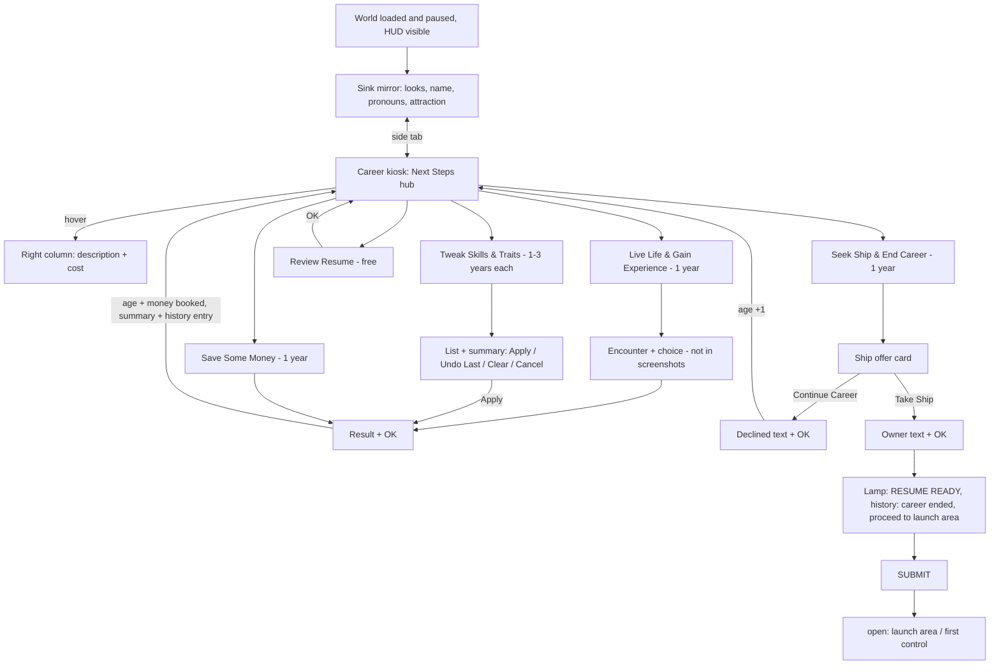

# Ostranauts – Start Flow: Character Creation to Ship Registration (Reference Memory)

Source: 29 screenshots of one playthrough, taken by the project owner (Ostranauts **Release Build 1.0.1.5**,
build number visible in the top-right corner). Evidence level: **gemessen** (observed in the running game)
unless marked *(derived)* or *(open)*.
Character in the screenshots: randomly named, 1 Tweak (Combat Engineering), 1 Save Some Money,
2 Seek Ship (1 declined, 1 taken).
In-game texts are paraphrased here, not copied. Weltraum Game uses its own names and texts.
Related: ostranauts-character-creation.md (wiki data for all options), ostranauts-flying.md (tutorial after launch).

**Not covered by the screenshots** *(open)*: program start, splash screens, main menu, new-game options,
the Live Life encounter screens, everything after **Submit** (launch area, first free control).

---

## 1 Summary
1. Character creation happens **inside the game world**, not in a separate menu: the world is already loaded
   and **paused** (PAUSE label, clock UTC 2079-08-26 13:54), the HUD is visible at the bottom.
2. Two in-world screens, switched with side tabs: a **sink mirror** (looks, name, pronouns) and a
   **career kiosk** (Build-a-Resume). You can switch back and forth at any time.
3. The kiosk is a hub ("Next Steps") with 5 buttons. Hovering a button explains it and shows its cost in years.
4. Every year-costing action shows a **result screen with OK**. Age and money change only **after OK**.
5. Every action adds a block to the **Career Summary** (right column) and a dated entry to the **Event History**.
6. **Seek Ship** shows one random ship with stats, mortgage and payment per shift → **Take Ship** or **Continue Career**.
7. Taking a ship ends the career. A status lamp switches from **NOT FINISHED** to **RESUME READY**, and **SUBMIT** ends creation.

## 2 Flow diagram

## 3 Screens in detail

### 3.1 World and HUD during creation
- Background: the player's room with mirror and kiosk; graffiti on the walls.
- HUD bottom: portrait, name, need bars, money ($96.79), **AUTOTASK** and **AUTOPAUSE** buttons,
  message log, clock with pause / play / fast-forward (x1), shift slider ("SHIFT").
- The message log already describes the start condition in second person: trouble sleeping, tiring easily,
  bad piloting, vision impairment, working as a shipbreaker, the two starting skills.
- "?" help button top left. Release build number top right.

### 3.2 Sink mirror (portrait)
Framed as an **in-world dating app** on the mirror.
| Element | Details |
|---|---|
| Pronoun | Single choice: he/him, she/her, they/them (with "?" help) |
| Flirts with | Multiple choice checkboxes: he/him, she/her, they/them (with "?" help). Becomes the traits "Attracted to Men / Women / Non-binary People" |
| Name | Text field + its own RANDOMIZE button |
| Portrait | Live preview + RANDOMIZE (whole look) + **DONE!** |
| Appearance selectors (◀ ▶, "current/total") | Skin 3, Hair 64, Scar 18, Glasses 15, Beard 50, Pupils 20, Eyes 11, Nose 10, Teeth 3, Lips 5, Neck 3, Head 2, Body 2 |
| Large preview | Face close-up, plus a small full-body silhouette |

### 3.3 Build-a-Resume kiosk – layout
- Header: department name + "Build-a-Resume Center".
- **Progress bar** with 4 nodes: START → DOCUMENTING CAREERS → VESSEL REGISTRATION → FINISH.
- Status bar: **Name · Age · Net Worth** (always visible).
- Left column: current step (text + buttons). Right column: **Career Summary** (scrollable log), or the
  hover explanation of a hub button.
- Far right: lamp **NOT FINISHED** (red) / **RESUME READY** (green) and a **SUBMIT** button.

### 3.4 Start state (age 18, before any action)
| Value | Start |
|---|---|
| Age | 18 |
| Net worth | $96.79 |
| Homeworld | the K-Leg station on asteroid 1036 Ganymed |
| Career | Shipbreaker ("Career Change: Shipbreaker") |
| Skills & attributes | Shipbreaker, Spaceship Engineering, Zero-g Ops |
| Traits | Youthful, Feeble, Fragile, Micro-g Hypovolemic, Immunosuppressed, Insomniac, Slow Metabolism, Unfit, Visually Impaired + the attraction traits from the mirror |
| Contacts | **2 generated parents** with portrait, same surname, job and origin (here: a shipbreaker from Mars, a manager from Titan) |
| Event history | "Early Life": a short medical-exam scene that explains every start trait in story form and ends with the work permit for the boneyard. Then the two parents. |

**Difference from the wiki:** the wiki lists *Sharp Hearing* as a start trait. In build 1.0.1.5 it is **not** in the
Review Resume trait list.

### 3.5 Next Steps hub
- Fixed intro text: the dream of an own salvage ship is still out of reach; how will you spend the coming years?
- Buttons and hover help (right column):
| Button | Hover text (paraphrased) | Cost |
|---|---|---|
| Live Life & Gain Experience | live a year, look for opportunities; changes traits, skills and cash; **the only way to get relationships and starting items** during creation | 1 year |
| Tweak Skills & Traits | invest time in skills or change traits; meant for fine-tuning near the end | 1–3 years each; aging also affects traits |
| Save Some Money | focus on work for guaranteed cash, at the expense of everything else | 1 year |
| Review Resume | summary of all choices so far | free |
| Seek Ship & End Career | look for an affordable ship on the market; **choosing a ship ends the career** | 1 year |

### 3.6 Tweak Skills & Traits
- Left: intro text (self-improvement through study), then scrollable lists **Skills**, Hobbies, **Traits**.
- Every entry has a status box:
  - empty = available
  - **thumbs-up** = owned or selected
  - **lock** = blocked because the opposite trait is owned (e.g. Strong is locked while Feeble is owned; Fast Metabolism is locked while Slow Metabolism is owned)
  - small markers next to the box: *(derived)* probably the cost
- Hover tooltip: name, description, "Cost: N year(s)".
- Right: **Summary** with "Selected Skills | Costs", one line per selection ("+ Skilled in Combat Engineering – 3 years"),
  **Total Cost**, and the buttons **Apply / Undo Last / Clear**. Bottom left: **Cancel**.
- Age-stage notice in red in the summary: "You have grown into a young adult." (preview 18 + 3 = 21). After that the
  trait **Young Adult** is in the list, **in addition to** Youthful.
- After Apply: age 18 → 21. Summary block: "Career Cont'd: Shipbreaker / Skills & Attributes: Skilled in Combat
  Engineering, Shipbreaker." History: "Age 18, Career: Shipbreaker – Worked On Self: Skilled in Combat Engineering".

### 3.7 Save Some Money
- Result screen: short story (save harder, eat cheaper, extra shifts) + **OK**. The header still shows the old age (21).
- After OK: age 22, net worth $96.79 → **$660.72** (+$563.93, inside the wiki range of $300–600).
- Summary block: "Career Cont'd: Shipbreaker / Skills & Attributes: None / Rewards: $563.93".

### 3.8 Review Resume (free, no age change)
- Left: Name; Age, Homeworld, Net Worth; **Traits** (3-column grid); **Skills**; **Event History**
  (chronological, "Age: N, Career: …" + text), **OK** at the bottom.
- Right: the Career Summary stays visible.

### 3.9 Seek Ship & End Career – ship offer
- Card: short title (e.g. "Small Shuttle."), 2–3 sentence story about the seller and the ship, then a legal rating line
  from the ship registry (OSR "moderate" = legal for sale, only basic travel and life support).
- Top-down **picture of the ship** + data list:

| Field | Offer 1 | Offer 2 |
|---|---|---|
| Make / Model | Testudo Dream | Ryokka TU-76a |
| Year | 2057 | 2057 |
| Designation | Passenger Shuttle | Salvage Tug |
| Dimensions | 7.04 m × 5.12 m | 4.80 m × 8.96 m |
| Mass | 4645.865 kg | 5725.125 kg |
| RCS Count | 2 | 4 |
| Torch Drive | No | No |
| Location / Docked | OKLG / Yes | OKLG / Yes |
| **Mortgage** | 862,808.40 | 811,731.50 |
| **Payment per shift** | 2,325.39 | 2,187.73 |

- *(derived)* In both offers the payment per shift = mortgage ÷ **371.04**. So the loan seems to run about 371 shifts.
- *(derived)* Mass per thruster: Dream ≈ 2323 kg (thrust rank E), TU-76a ≈ 1431 kg (rank D). Same scale as ostranauts-ship-building.md 2.2.
- Buttons: **Take Ship** / **Continue Career**. The result text appears below the card, the buttons are greyed out, then **OK**.
- **Continue Career:** short "not yet" text + OK. Age 22 → **23** after OK. The declined offer stays in the Event History.
- **Take Ship:** owner text (you can now reach the outer derelicts; options: resell parts, gigs, find ships) + OK.
  History and summary end with "Ship J-02Y4 ("Ryokka TU-76a") acquired. Career ended. **Proceed to Launch Area.**"
  The lamp switches to **RESUME READY** (green).
- *(open)* whether a successful Take Ship also costs the year. The age shown at the offer is 23, but no screenshot
  shows the age after OK.
- Each ship gets a **hull registry ID** (here J-02Y4).

### 3.10 Timing rule *(observed in 3 cases)*
The result screen always shows the **old** age. The year is booked when **OK** is pressed (Save Money: 21 → 22;
declined ship: 22 → 23). Tweak books its total cost on **Apply**.

## 4 Age timeline of this playthrough
| Age | Action | Net worth |
|---|---|---|
| 18 | Start (early life, parents) | $96.79 |
| 18 → 21 | Tweak: Combat Engineering (3 years) | $96.79 |
| 21 → 22 | Save Some Money | $660.72 |
| 22 → 23 | Seek Ship: Testudo Dream offered, declined | $660.72 |
| 23 → ? | Seek Ship: Ryokka TU-76a offered, taken → RESUME READY | $660.72 |

## 5 Comparison with Weltraum Game (code as of commit 00a622f)
Already similar (`scripts/character/character_system.gd`, `scripts/ui/character_ui.gd`, `data/careers.json`):
- start at 18, max 47, start traits + Spaceship Engineering + Zero-g Ops, aging at 29/42
- Tweak as drafts with preview age and year balance
- encounters with RISK tokens, Save Some Money 300–600, Seek Ship 1 year with random offer, decline / buy, forced at 47
- life-story lines, contacts and enemies from encounters

Not found in the code (gaps compared to the original):
- no identity step: the player is the fixed "Mira Okafor"; no pronouns, no attraction, no look selection
- no generated parents at the start, and no early-life text that explains the start traits
- creation is one panel: no hub with hover help, no separate result screen with OK, no Review Resume
- no Undo Last / Clear in the Tweak step, no icons for owned / locked
- no age-stage notice like "young adult"
- the ship offer has no data card: no make, year, dimensions, mass, RCS count, picture, safety rating, payment per shift
- no gate RESUME READY → SUBMIT → launch area; no progress bar
- creation is not framed in the world (Ostranauts: paused world, mirror + kiosk in the room)

## 6 Design ideas for Weltraum Game (own names and texts)
1. **In-world start:** load the station room first, paused. Creation runs on two devices in the room (e.g. a mirror
   terminal and a labour-office terminal). The player sees the world they are about to enter.
2. **Identity step:** name with random button, pronoun choice, attraction checkboxes → traits, a few appearance
   selectors with "n/total" counters and a random button for everything.
3. **Origin story:** a short generated medical or registry scene explains each start trait. That turns a list of
   weaknesses into a story.
4. **Two generated relatives** as the first contacts (job + origin world). They give later quests a family hook.
5. **Hub with help column:** every button explains itself on hover and shows the cost in years before you commit.
6. **Result screen + OK, then book:** consequences are shown first, age and money change on confirm.
   Every step adds a block to a running summary.
7. **Free review screen** with traits, skills and the full history.
8. **Ship offer card:** picture, data list, safety rating, total debt **and payment per shift**. Then take or continue.
   This makes the debt concrete before the first minute of play.
9. **Explicit end gate:** status lamp + Submit + a clear next goal ("go to the launch area"). The player knows when
   creation is over and where to go.
10. **Progress bar** with 3–4 stages, so the player knows how far along they are.

## 7 Open (not in the screenshots)
- program start, splash, main menu, new-game options
- the full encounter flow of Live Life (text, choices, result screen)
- age after Take Ship; whether the lamp stays green if you keep acting afterwards
- what Submit does: transition, launch area, spawn point, start inventory, start time, first tutorial goals
- the meaning of the small markers next to the Tweak status boxes
- how the progress bar nodes fill (all screenshots look similar)
